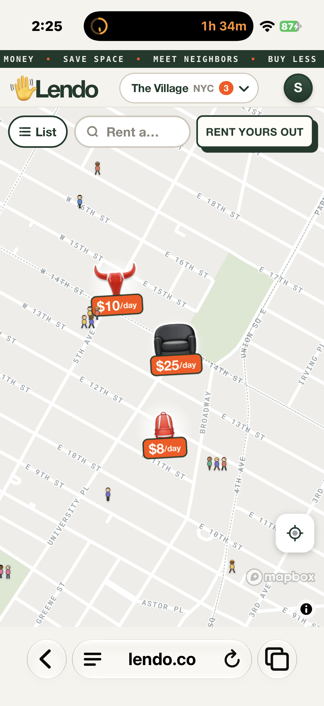
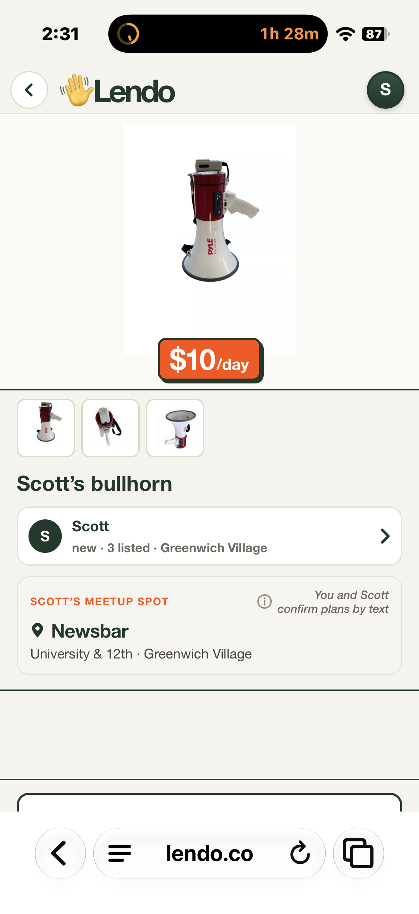
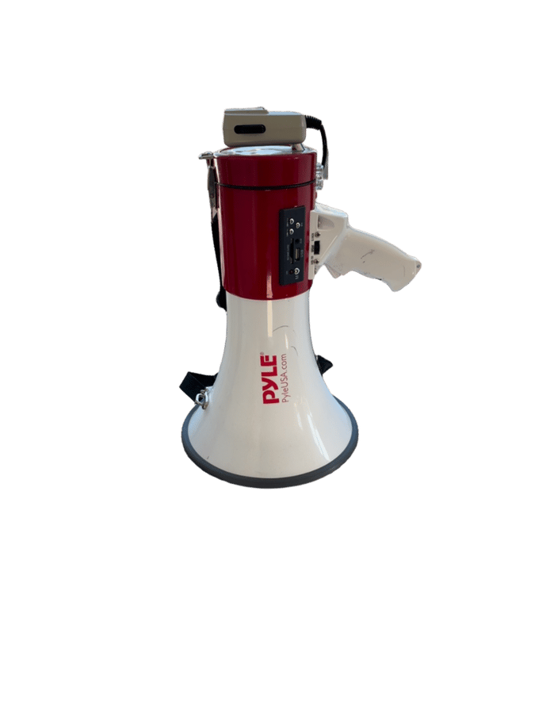
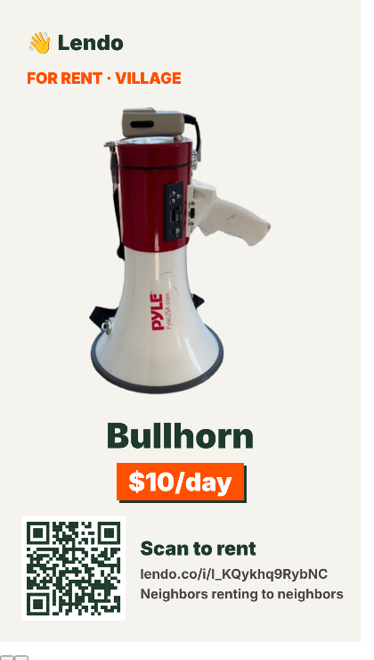

# The bullhorn that became a bull (Nov 10, 2026)

Scott listed his Pyle bullhorn (megaphone) in the Village for $10/day. The listing photos were right. The map icon, drawn by AI from the word "bullhorn", came out as a red bull's head with horns.

| Map pin (AI drawing) | Item page (real photo) |
|---|---|
|  |  |

## Why it happened
- The image model (Flux) reads words literally: "bullhorn" → bull + horns
- Nothing checked the drawing against the photo before it went on the map
- Same day, same failure mode in the wanted catalog: "air fryer" drawn as fries, "orbital sander" as logs, people/babies as emoji stand-ins

## What changed
- Claude looks at the photo and writes the drawing prompt in plain physical terms ("handheld electric megaphone with a pistol grip…")
- Every drawn icon is compared with the photo ("same kind of object?"); one redraw, then fall back to the real photo cut out
- Existing icons are audited and redrawn if wrong; wanted-catalog icons get the same check
- Map ghosts only use drawn, checked icons — no emoji stand-ins

## Same listing, after
The real photo, cut out, became the share story card:

 
